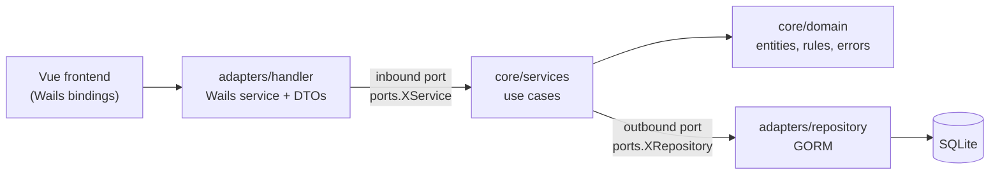

# InventarioWails

**A lightweight desktop inventory management system built with Go, Wails 3, Vue 3, TypeScript, and SQLite.**

InventarioWails is a local-first desktop application designed to simplify inventory management for small and medium-sized retail operations. It provides tools to manage products, organize categories, track stock movements, and process sales — all without requiring an external server.

## Overview

The backend is split into self-contained business **modules**, each built with a **hexagonal (ports & adapters)** design: the business core knows nothing about Wails, GORM, or SQLite, and talks to the outside world only through interfaces it owns.

- **Local-first:** All data is stored locally in SQLite (pure-Go driver, no CGO).
- **Hexagonal modules:** Category, product, stock, and sale each have their own core (domain, ports, services) and adapters (Wails handler, GORM repository).
- **Transactional consistency:** A Unit of Work keeps product stock, stock movements, and sales in sync — a sale and all its stock deductions commit or roll back together.
- **Inventory tracking:** Every stock change is recorded as a typed movement with a full history per product.
- **Sales management:** Register sales with multiple products, priced from current product data.
- **Desktop experience:** A Vue 3 + shadcn-vue interface with light/dark themes, integrated with Go through typed Wails 3 bindings.

## Features

### Categories

- Create, list, search, update, and soft-delete categories.
- Restore previously deleted categories.
- Validate required names and reject duplicates.
- Paginated listing (newest first) with name search and an "only inactive" filter.
- Lightweight `{id, name}` option list for select inputs.

### Products

- Create, list, search, update, and delete products.
- Assign products to an optional category (unset automatically if the category row is removed).
- Search by name, code, or barcode, and filter by one or more categories.
- Validate required name and code, a positive price, and non-negative stock.
- Reject duplicate product codes.
- Activate or deactivate products (inactive products cannot be sold).
- Flag low-stock products (`stock <= min_stock`) in every response.
- Stock is not editable from the product form — after creation it only changes through stock movements.

### Inventory Control

- Register manual adjustments (`adjustment_in` / `adjustment_out`) with optional notes.
- Quantities are always positive; the movement type decides the direction.
- Prevent any movement that would leave stock below zero.
- Update the product's stock and record the movement in a single transaction.
- Review the movement history for a product (newest first).

> The stock adjustment UI is not wired into the frontend yet; the backend service and bindings are available.

### Sales

- Build a sale in a cart with product search, then check out.
- Require at least one item and positive quantities.
- Reject inactive products and quantities exceeding available stock.
- Snapshot each product's current price as the item's unit price and compute subtotals and the sale total.
- Save the sale and deduct stock for every item (as `sale` movements) atomically.
- Paginated sales list (newest first) and a detail view with the sold products.

### User Interface

- Sidebar navigation for Products, Categories, and Sales.
- Light and dark themes, remembered between sessions.
- Prices formatted as Chilean pesos (CLP).
- Spanish-language interface and domain error messages.

### Data Persistence

- Store application data locally in SQLite with foreign keys and WAL journaling.
- Schema defined as GORM models and applied automatically at startup with `AutoMigrate`.
- Operate independently of external services.

## Domain Models

Each module owns its domain types under `core/domain`. Monetary values are stored as integers (`int64`).

### Category

| Field | Type | Notes |
| --- | --- | --- |
| `ID` | `int64` | |
| `Name` | `string` | Unique |
| `CreatedAt` | `time.Time` | |
| `UpdatedAt` | `time.Time` | |
| `DeletedAt` | `*time.Time` | `nil` when active (soft delete) |

`Category.IsActive()` reports whether `DeletedAt` is `nil`.

### Product

| Field | Type | Notes |
| --- | --- | --- |
| `ID` | `int64` | |
| `CategoryID` | `*int64` | Optional; set to `NULL` when the category is deleted |
| `Name` | `string` | Required |
| `Code` | `string` | Required, unique |
| `Barcode` | `string` | Optional |
| `Price` | `int64` | Must be greater than zero |
| `Stock` | `int` | Never negative |
| `MinStock` | `int` | Low-stock threshold |
| `Active` | `bool` | |
| `CreatedAt` | `time.Time` | |
| `UpdatedAt` | `time.Time` | |

`Product.HasLowStock()` returns `true` when `Stock <= MinStock`.

### Sale

| Field | Type |
| --- | --- |
| `ID` | `int64` |
| `Total` | `int64` |
| `Items` | `[]SaleItem` |
| `CreatedAt` | `time.Time` |

### SaleItem

| Field | Type | Notes |
| --- | --- | --- |
| `ID` | `int64` | |
| `SaleID` | `int64` | |
| `ProductID` | `int64` | |
| `Product` | `*SaleProduct` | `{ID, Name, Code}`, loaded when reading a sale |
| `Quantity` | `int` | Greater than zero |
| `UnitPrice` | `int64` | Product price at the time of sale |
| `Subtotal` | `int64` | `UnitPrice × Quantity` |
| `CreatedAt` | `time.Time` | |

### Movement (stock)

| Field | Type | Notes |
| --- | --- | --- |
| `ID` | `int64` | |
| `ProductID` | `int64` | |
| `Quantity` | `int` | Always greater than zero |
| `MovementType` | `MovementType` | Decides the direction |
| `Notes` | `string` | |
| `CreatedAt` | `time.Time` | |

Movement types and their effect on stock (`Movement.Delta()`):

| Type | Effect | Registered by |
| --- | --- | --- |
| `adjustment_in` | `+Quantity` | Manual adjustment (count found more stock) |
| `adjustment_out` | `−Quantity` | Manual adjustment (count found less stock) |
| `sale` | `−Quantity` | Sale module |
| `return` | `+Quantity` | Reserved for customer returns |

## Architecture

The codebase combines **vertical slices** (one module per business capability under `internal/modules/<feature>`) with a **hexagonal architecture** inside each module. Cross-cutting infrastructure lives under `internal/platform`.

```text
InventarioWails/
├── main.go                       # Wails 3 entrypoint; embeds frontend, registers services
├── app/
│   ├── app.go                    # Bootstrap: DB path resolution, open + migrate, lifecycle
│   └── wire.go                   # Builds modules and injects cross-module dependencies
├── cmd/
│   └── seed/                     # Standalone CLI to seed sample categories and products
├── database/
│   └── schema.go                 # GORM schema models + Migrate (AutoMigrate)
├── internal/
│   ├── modules/
│   │   ├── category/
│   │   │   ├── category.go       # Module composition root: New(db) wires adapters ⇄ core
│   │   │   ├── core/
│   │   │   │   ├── domain/       # Entities, invariants/validators, errors, query objects
│   │   │   │   ├── ports/        # Inbound (service) and outbound (repository) interfaces
│   │   │   │   └── services/     # Use-case implementations of the inbound port
│   │   │   └── adapters/
│   │   │       ├── handler/      # Driving adapter: Wails service + request/response DTOs
│   │   │       └── repository/   # Driven adapter: GORM repository + query scopes
│   │   ├── product/              # Same layout
│   │   ├── stock/                # Same layout
│   │   └── sale/                 # Same layout
│   └── platform/                 # Shared, domain-agnostic building blocks
│       ├── gormdb/               # SQLite connection, Unit of Work, ctx-aware Conn, error helpers
│       ├── uow/                  # Unit of Work port (no infrastructure dependencies)
│       ├── pagination/           # Generic GORM pagination (Params, Result[T], Paginate)
│       └── responses/            # Shared DTO helpers (PageResponse, MapSlice, FormatTime)
├── frontend/                     # Vue 3 + TypeScript + Vite app
│   ├── src/                      # Views, components, composables, services, router, types
│   └── bindings/                 # Auto-generated Wails TypeScript bindings
└── build/                        # Wails 3 build config and per-platform Taskfiles
```

### Hexagonal layers within each module



| Layer | Responsibility |
| --- | --- |
| `core/domain` | Entities, invariants (`Validate`), domain errors, and query objects. No framework imports. |
| `core/ports` | Interfaces owned by the core: the **inbound** service port (what the module offers) and **outbound** ports (what it needs: repositories, other modules). |
| `core/services` | Implement the inbound port by orchestrating the domain and outbound ports. |
| `adapters/handler` | **Driving** adapter: exposes the service to the frontend as a Wails service and maps DTOs ⇆ domain. |
| `adapters/repository` | **Driven** adapter: implements the repository port with GORM, using private persistence models and translating storage errors into domain errors. |
| `<feature>.go` | The module's composition root: `New(...)` assembles repository → service → handler and exposes only what other parts of the app need. |

Dependencies always point inward: adapters depend on ports, ports depend on the domain, and the core never imports an adapter.

### Cross-module collaboration

Modules depend on **narrow ports** they define themselves, not on other modules' implementations. [app/wire.go](app/wire.go) connects them:

```go
categoryMod := category.New(a.db)
productMod  := product.New(a.db)
stockMod    := stock.New(a.db, productMod.Repository())
saleMod     := sale.New(a.db, productMod.Repository(), stockMod.Service())
```

- **Stock** needs only `FindByID` and `UpdateStock` from products (`stock/core/ports.ProductRepository`).
- **Sale** needs `FindByID` from products and a `StockMovementRegistrar` — satisfied by the stock service — so every stock change, including sales, goes through a single code path that records a movement.

### Transactions (Unit of Work)

The `uow.UnitOfWork` port lets use cases group repository calls atomically without depending on GORM:

- `gormdb.UnitOfWork.Do(ctx, fn)` opens a transaction and passes `fn` a context carrying it.
- Repositories obtain their handle with `gormdb.Conn(ctx, db)`, so they automatically join the active transaction.
- A nested `Do` joins the outer transaction instead of starting a new one; the outermost call decides commit or rollback. Errors and panics roll back.

When a sale is created, the sale service opens a unit of work, saves the sale, and calls the stock service for each item; the stock service's own `Do` joins that transaction. If any item lacks stock, the whole sale is rolled back.

### Wails services and exposed methods

`main.go` registers four handlers as Wails services, which generate strongly typed TypeScript bindings in `frontend/bindings`:

| Service | Methods |
| --- | --- |
| `CategoryHandler` | `ListCategories`, `ListCategoryOptions`, `GetCategory`, `CreateCategory`, `UpdateCategory`, `DeleteCategory`, `RestoreCategory` |
| `ProductHandler` | `ListProducts`, `GetProduct`, `CreateProduct`, `UpdateProduct`, `DeleteProduct`, `ToggleActiveProduct` |
| `StockHandler` | `AdjustStock`, `ListStockMovements` |
| `SaleHandler` | `CreateSale`, `ListSales`, `GetSale` |

List endpoints return a shared `PageResponse` envelope: `items`, `total`, `page`, `page_size`, `total_pages` (default page size 10, max 100).

### Frontend

The Vue app lives in `frontend/src`:

| Folder | Contents |
| --- | --- |
| `views/` | Screens per feature: category list + dialogs, product list/create/edit, sale list/create/detail |
| `components/` | Shared UI: app layout and sidebar, page header, search input, product search select, theme toggle |
| `composables/` | Reusable state and logic (`useProducts`, `useCategories`, `useSales`, `useSaleCart`, `usePagination`, `useTheme`, `useLeaveGuard`, …) |
| `services/` | Thin wrappers around the generated Wails bindings |
| `router/` | Vue Router routes (memory history) |
| `types/`, `utils/` | Frontend types, currency/date/sale helpers |

## Technology Stack

### Backend

| Technology | Purpose |
| --- | --- |
| [Go](https://go.dev/) 1.26 | Backend and business logic |
| [Wails 3](https://v3alpha.wails.io/) (`v3.1.0`) | Native desktop application framework |
| [GORM](https://gorm.io/) | ORM, query scopes, transactions, and `AutoMigrate` |
| [SQLite](https://sqlite.org/) via [modernc.org/sqlite](https://pkg.go.dev/modernc.org/sqlite) | Pure-Go local database driver (no CGO) |
| [godotenv](https://github.com/joho/godotenv) | `.env` loading |
| [testify](https://github.com/stretchr/testify) | Test assertions |

### Frontend

| Technology | Purpose |
| --- | --- |
| [Vue 3](https://vuejs.org/) | Frontend framework (Composition API, `<script setup>`) |
| [TypeScript](https://www.typescriptlang.org/) | Type safety |
| [Vite](https://vite.dev/) | Build tooling and dev server |
| [Vue Router](https://router.vuejs.org/) | Client-side routing |
| [Pinia](https://pinia.vuejs.org/) | State management |
| [shadcn-vue](https://www.shadcn-vue.com/) ([Reka UI](https://reka-ui.com/)) + [Lucide](https://lucide.dev/) | UI components and icons | 
| [Tailwind CSS](https://tailwindcss.com/) 4 | Styling |
| [Prettier](https://prettier.io/) | Code formatting |
| [pnpm](https://pnpm.io/) | Package manager |

## Getting Started

### Prerequisites

- Go 1.26
- Node.js and [pnpm](https://pnpm.io/)
- [Wails 3 CLI](https://v3alpha.wails.io/getting-started/installation/) (`wails3`)
- Platform build dependencies required by Wails 3
- Optional: `make` or [Task](https://taskfile.dev/) for the shortcut commands

> SQLite uses the pure-Go `modernc.org/sqlite` driver, so a C compiler is **not** required for the database.

### Installation

```bash
git clone <repository-url>
cd inventariowails

cp .env.example .env

cd frontend
pnpm install
cd ..
```

### Development

Run the application in development mode (live reload for Go and frontend):

```bash
wails3 dev -config ./build/config.yml -port 9245
# or
make dev
```

### Production Build

```bash
wails3 build      # build for the host platform
wails3 package    # create a distributable package
```

Run `wails3 --help` to see every available command.

### Seeding the database

A standalone CLI migrates the schema and seeds sample categories and products into the configured database:

```bash
go run ./cmd/seed
# or
make seed
```

### Testing

Run the full Go test suite (domain validators, services with mocked ports, GORM repositories against in-memory SQLite, the Unit of Work, and response helpers):

```bash
go test ./...
```

CI ([.github/workflows/test.yml](.github/workflows/test.yml)) runs `go test -v ./internal/...` on pushes and pull requests to `main` and `develop`.

### Formatting

```bash
make fmt          # format frontend sources with Prettier
make fmt-check    # check formatting without writing
```

## Configuration

### Environment variables

Copy `.env.example` to `.env` and adjust it for your environment (`.env` is gitignored). Both the app and the seed command read these values.

| Variable | Description |
| --- | --- |
| `ENV` | Set to `development` to use `inventario_dev.db` in the working directory. Any other value (or unset) uses the production path. |
| `DB_PATH` | Optional explicit database file path. When set, it takes precedence over `ENV`. |

Database path resolution (see `ResolveDBPath` in [app/app.go](app/app.go)):

| Condition | Database location |
| --- | --- |
| `DB_PATH` is set | The value of `DB_PATH` |
| `ENV=development` | `inventario_dev.db` in the working directory |
| Otherwise (production) | `inventario/inventario.db` under the OS user config directory |

The SQLite connection enables foreign keys and WAL journaling and uses a single open connection (SQLite allows one writer).

### Schema changes

[database/schema.go](database/schema.go) is the source of truth for tables, constraints, and foreign keys. Repositories keep their own partial models mapped to the same tables so modules stay decoupled.

`AutoMigrate` only **adds** missing tables, columns, indexes, and constraints; it never drops or renames columns or migrates data. Such changes must be added to `database.Migrate` as explicit steps using `db.Migrator()`.

### Build configuration

Application metadata (product name, identifier, version, icons) for packaging lives in [build/config.yml](build/config.yml). Per-platform build and packaging steps are defined in the Taskfiles under `build/<platform>/`.

## Design Principles

- **Ports & adapters:** The core defines the interfaces it needs and offers; Wails and GORM are plug-in adapters.
- **Modularity:** Each feature is a self-contained slice that can be developed and tested in isolation.
- **Narrow cross-module ports:** A module asks only for the operations it uses, wired together at the application root.
- **Single path for stock changes:** All stock updates go through the stock service, so stock and movement history never diverge.
- **Atomic workflows:** Multi-step operations run inside a Unit of Work.
- **Data integrity:** Domain validation plus database constraints (unique, foreign key, check) prevent invalid inventory and sales records.
- **Local persistence:** The application works without a separate backend server.

## License

See [LICENCE](LICENCE).

---

*Built with Go, Wails 3, Vue 3, TypeScript, and SQLite.*
